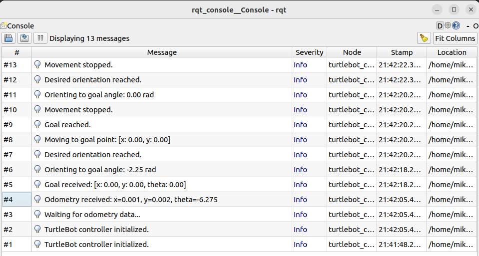
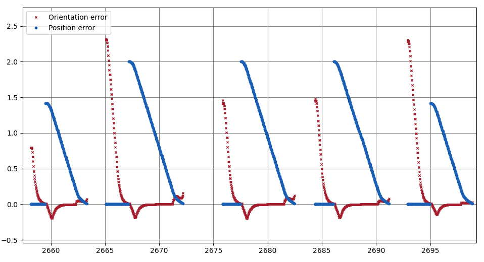
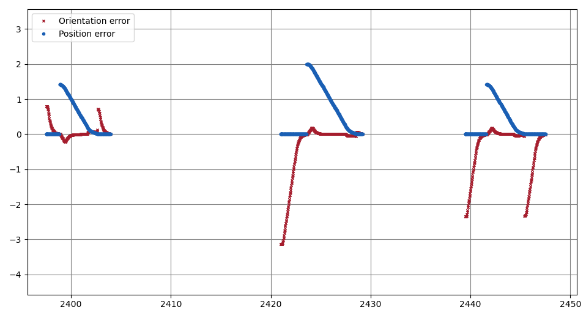
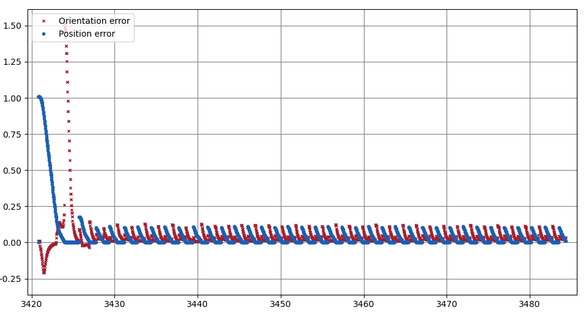
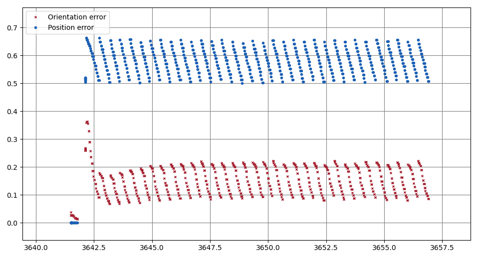

# Exercise 3: TurtleBot
## Task 1: TurtleBot simulation
The objective of this task is to get familiar with the turtlebot simulation and how to utilize it.<br>
Complete the following tasks:

1. Open 2 terminals and execute the following command:
    ```bash
    $ ros2 run turtlesim turtlesim_node
    $ ros2 run turtlesim turtle_teleop_key
    ```
2. Try out the tele-operation and investigate the topics and nodes with suitable ROS commands

    Using rqt to investigate the relevant topics, we can find:
    ```
    /turtle1/pose
    /turtle1/color_sensor
    /turtle1/rotate_absolute/_action/feedback
    /turtle1/cmd_vel
    /turtle1/rotate_absolute/_action/status
    ```
    The relevant nodes found from rqt node graph are:
    ```
    /turtlesim
    /teleop_turtle
    ```
3. Find out what topic and message are used for sending velocity commands to the TurtleBot

    Using rqt node graph, it can be seen that the node `/teleop_turtle` sends velocity commands to the node `/turtlesim` through the topic `/turtle1/cmd_vel`. The message type is `geometry_msgs/msg/Twist` which holds linear and angular fields with message types `geometry_msgs/msg/Vector3` that hold velocities for x, y and z directions.

4. Use the ros2 topic command to move the robot in a circle and in a square path

    A circular path can be achieved with some velocity in x or y direction and angular velocity with respect to the z-axis. The command for this is:
    ```bash
    $ ros2 topic pub /turtle1/cmd_vel geometry_msgs/msg/Twist '{linear: {x: 1.0}, angular: {z: 1.0}}'
    ```
    One way to achieve a square path accurately is by specifying how many times the velocity command is published. If we want a square with a side length of 3 m, do the following commands sequentially 4 times (the first turn is not necessary):
    ```bash
    $ ros2 topic pub --once /turtle1/cmd_vel geometry_msgs/msg/Twist "{angular: {z: 1.57}}"
    $ ros2 topic pub --once /turtle1/cmd_vel geometry_msgs/msg/Twist "{linear: {x: 3.0}}"
    ```
    The `--once` option specifies that the message should be published only once.
5. Find a way to concatenate multiple commands to achieve consecutive motions

    Multiple commands can be concatenated if we use the && operator in between commands in the command line. The && operator waits for the previous command to succeed before proceeding. The full command would look like this:
    ```bash
    $ ros2 topic pub --once /turtle1/cmd_vel geometry_msgs/msg/Twist "{linear: {x: 3.0}}" && ros2 topic pub --once /turtle1/cmd_vel geometry_msgs/msg/Twist "{angular: {z: 1.57}}" && ros2 topic pub --once /turtle1/cmd_vel geometry_msgs/msg/Twist "{linear: {x: 3.0}}" && ros2 topic pub --once /turtle1/cmd_vel geometry_msgs/msg/Twist "{angular: {z: 1.57}}" && ros2 topic pub --once /turtle1/cmd_vel geometry_msgs/msg/Twist "{linear: {x: 3.0}}" && ros2 topic pub --once /turtle1/cmd_vel geometry_msgs/msg/Twist "{angular: {z: 1.57}}" && ros2 topic pub --once /turtle1/cmd_vel geometry_msgs/msg/Twist "{linear: {x: 3.0}}"
    ```

## Task 2: TurtleBot control
The objective of this task is to achieve closed-loop control of a simulated mobile robot within
Gazebo environment. The robot we are going to simulate for this task is the Waffle Pi of the
Turtlebot3 family.
Preparations for Turtlebot3 Simulation
1. Install dependencies following the Quick Start Guide for PC setup, starting from “Install
Dependent ROS 2 Packages”:
(Follow only the Humble tab)
https://docs.robotis.com/docs/systems/turtlebot3/quick_start_guide/pc_setup
2. Install Simulation package and run examples:
(Follow only the Humble tab)
https://docs.robotis.com/docs/systems/turtlebot3/simulation/gazebo_simulation

### Task 2.1:
1. Launch turtlebot3_world.launch or turtlebot3_house.launch from the turtlebot3_gazebo
package.
2. Investigate the topics/nodes then find the topic/message required for commanding the
robot.

    First launch turtlebot3_world.launch and run teleoperation from another terminal. Using rqt node graph, we can find nodes:
    ```
        /turtlebot3_laserscan
        /turtlebot3_imu
        /turtlebot3_diff_drive
        /turtlebot3_joint_state
        /gazebo
        /teleop_keyboard
        /robot_state_publisher
    ```
    With teleoperation on, we can see that the `/teleop_keyboard` will publish to `/cmd_vel` to which `/turtlebot3_diff_drive` is subscribed to.

    The topics we can find are:
    | Topic                | Type                                      |
    |----------------------|-------------------------------------------|
    | `/tf`                | `tf2_msgs/msg/TFMessage`                  |
    | `/tf_static`         | `tf2_msgs/msg/TFMessage`                  |
    | `/robot_description` | `std_msgs/msg/String`                     |
    | `/scan`              | `sensor_msgs/msg/LaserScan`               |
    | `/joint_states`      | `sensor_msgs/msg/JointState`              |
    | `/imu`               | `sensor_msgs/msg/Imu`                     |
    | `/clock`             | `rosgraph_msgs/msg/Clock`                 |
    | `/parameter_events`  | `rcl_interfaces/msg/ParameterEvent`       |
    | `/rosout`            | `rcl_interfaces/msg/Log`                  |
    | `/odom`              | `nav_msgs/msg/Odometry`                   |
    | `/cmd_vel`            | `geometry_msgs/msg/Twist`                 |
    | `/performance_metrics` | `gazebo_msgs/msg/PerformanceMetrics`    |

3. Now, python will be used for motion control. Run the provided script:
```bash
$ python3 {path to file}/ros2_goforward.py
```
4. Study the code, which contains explanations of the statements in the comments, and
understand how it works.

    The code creates a Twist type message publisher to the topic `/cmd_vel`. A message with x linear velocity of 0.2 m/s and no z angular velocity will be published every 0.5 seconds. Can be stopped with keyboard interupt.

### Task 2.2:
We need to develop a ROS node in order to complete the following motion control tasks, by utilizing
feedback from the state of the robot:
1. Go to a point [x, y] in the workspace. Add the goal location as argument to input on the
command-line, such that new goals can be added online.
2. Go to a specific pose [x, y, theta] in the world space. Add the goal pose as argument to input
on the command-line, such that new goals can be added online.
3. Follow a predefined path. Define a suitable path (e.g., circle, square or something more
complex) and control the robot such that it follows it closely.
Take care of what the goal(s) of the robot are at different instances.
There can be many solutions. Present two.
4. Think of several ways how control could be improved. For example, by a better robot model,
separating control actions, better controller library, etc.

**Running the controller program:**

In one terminal:

```bash
$ export TURTLEBOT3_MODEL=burger
$ ros2 launch turtlebot3_gazebo empty_world.launch.py
```

In another terminal:

```bash
$ ros2 run turtlebot3_controller turtlebot3_controller
```

This will open up a prompt in the terminal to choose different objectives.
Remember to build and source.

**Solution:**

In our solution we used the given Go to Goal code as a basis to start.
- Replace rospy syntax with rclpy to support ROS2
- Since pose is not available for turtlebot3, we use odometry data from /odom

    From the odometry data, the position of robot can be exctracted directly. The orientation of the robot with respect to it's own z-axis (yaw) needs to be calculated based on the odometers quarternion data.

    $$ q =
    \begin{pmatrix}
    u_x \sin({\theta \over 2}) \cr
    u_y \sin({\theta \over 2})\cr
    u_z \sin({\theta \over 2})\cr
    \cos({\theta \over 2})\cr
    \end{pmatrix}
    $$

    The u components describe the axis around which rotation happens. Since we only care about rotation around the z-axis (yaw), we can set $u_x = 0$, $u_y = 0$ and $u_z = 1$. Then we get:

    $$ q =
    \begin{pmatrix}
    0 \cr
    0\cr
    \sin({\theta \over 2})\cr
    \cos({\theta \over 2})\cr
    \end{pmatrix}
    $$

    We can use the $q_z$ and $q_w$ components to get:

    $$
    \tan({\theta \over 2}) = {{\sin({\theta \over 2})} \over {\cos({\theta \over 2})}}
    $$

    And finally we get

    $$
    \theta = {2\arctan({q_z \over q_w})}
    $$
- Starting the code prompts user to choose between goals:
    - [x, y]: go to point
    - [x, y, theta]: go to point and rotate turtle (w.r.t itself) to theta
    - trajectory: follow trajectory
        - (circle/square/spline): choose a trajectory to follow
        - (p2p/smooth): choose how to follow trajectory
    - quit: quit the program

- We have three main movement functions in the code:

    move2goal:
    - Moves turtle to desired x, y point using proportional control on linear and angular velocity

    move2pose:
    - Orients turtle to a desired angle (w.r.t itself) utilizing proportional control on angular velocity

    move_along_trajectory:
    - Follow a chosen trajectory with either:
        - Point-to-point movement. Goes to next point, stops, goes to next point...
        - "smooth" movement. Always keeps some velocity. Velocity is inversly proportional to steering angle error: larger error, less velocity. Has radius around points between which the turtle moves.

- Control could be improved by e.g.:
    - Adding derivative action. Would help with overshoot
    - Analytical tuning methods for PID style controller. Would require a dynamical model of the robot.
    - Trajectory control could be improved by using better methods:
        - Pure pursuit which uses the already known future points to its advantage.
        - Model Predictive Control (if model was avaiable) that is able to use a prediction horizon to calculate a control horizon for optimal control inputs to stay within some contstraints like some trajectory boundary.
    
## Task 3:
1. Include suitable ROS info messages (with rosmsg) that indicate the status of the program.
For example, when TurtleBot received a new goal pose or reached the goal.
2. Monitor the messages with rqt_console.
3. Collect all necessary data to evaluate the performance of your controller, e.g., with rosbag
and plot the error with rqt_plot. Consider carefully what error is useful for evaluation.
4. Use a revision control system, such as https://gitlab.tuni.fi/

**Solution**

1.

When the program receives a new objective, the user is notified of the objective and its goal via .get_logger().info().

The different movement commands (move2goal, move2pose, move_along_trajectory, stop) all have their own info prints:
- move2goal: e.g. Moving to goal point: [x: 1.00, y: 2.00]
- move2pose: e.g. Orienting to goal angle: 0.42 rad
- move_along_trajcetory: if point-to-point mode chosen, will repeat move2goal and move2pose messages between waypoints. If smooth mode chosen, will not print anything else but the goal: Goal received: [trajectory: circle, follow mode: smooth]

2.

<p align="center">
  
  <br>
  <em>Fig 1. Example of rqt_console when going to [x: 0, y: 0, theta: 0].</em>
</p>

3.

Controller performance was evaluated mainly using the positional (euclidian distance) error and orientation error. Using rqt_plot, it is possible to investigate how quickly and accurately can the error be brought to zero in different situations.

<p align="center">
  
  <br>
  <em>Fig 2. rqt_plot of 5 different go to goal [x, y] errors.</em>
</p>

<p align="center">
  
  <br>
  <em>Fig 3. rqt_plot of 3 different go to goal and orientation [x, y, theta] errors.</em>
</p>

In Fig 2 and Fig 3 the empty space shows the times when the user is prompted to choose a new objective. The sudden jumps show when the controller got a new setpoint value.

<p align="center">
  
  <br>
  <em>Fig 4. rqt_plot of circular trajectory point-to-point following errors.</em>
</p>

<p align="center">
  
  <br>
  <em>Fig 5. rqt_plot of circular trajectory smooth following errors.</em>
</p>

In Fig 4 and Fig 5 the "choppy" data is due to rapid changes in setpoint, since the trajectories are formed as multiple sequential waypoints which the turtlebot moves through. In Fig 5 the errors don't reach 0 because the smooth mode doesn't strive to move the turtlebot exactly to the center of the waypoint.

The ros bag data of these different tests can be found in the /rosbag_data folder.